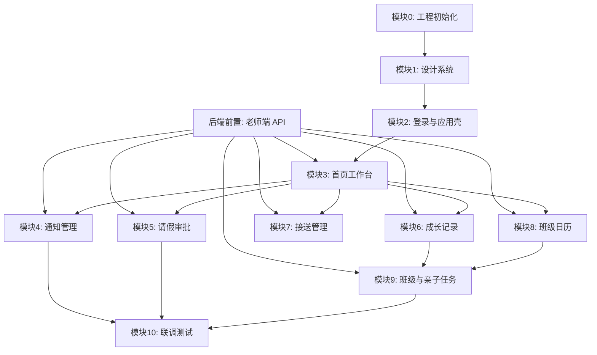

## 参考范围

- 设计稿：Calicat 文件 `2034425111476019200`，当前识别到 10 个页面：登录页、首页、发布通知页、成长记录页、接送管理页、班级日历页、请假审批页、成长记录详情页、添加活动页、拒绝请假弹窗。
- 工程模板：[teacher/MINI_PROGRAM_INIT_TEMPLATE.md](D:/yuanhaisu/personal_projects/kindergarten/teacher/MINI_PROGRAM_INIT_TEMPLATE.md)，当前老师端目录只有初始化模板，需先搭工程。
- API 文档：[backend/api/api-teacher.md](D:/yuanhaisu/personal_projects/kindergarten/backend/api/api-teacher.md)，覆盖首页、通知、请假、日历、成长记录、接送、班级学生、亲子任务。
- 设计问题清单：[design-data/teacher-calicat-design-issues.md](D:/yuanhaisu/personal_projects/kindergarten/design-data/teacher-calicat-design-issues.md)，实现时优先处理响应式、底部导航、交互映射、图标、点击区域等问题。

## 拆分原则

- 先搭基础能力，再做业务页面：请求、登录、路由、布局、组件和设计 token 必须先完成。
- 老师端后端接口目前尚未在 `server` 中注册实现，需先补 `/api/v1/teacher/*` 路由、处理器、服务和权限，再进入真实联调。
- 先闭环高频核心路径：首页待办、通知发布、请假审批优先，其次成长记录、接送、日历、亲子任务。
- 每个模块都包含页面、API 封装、状态处理、空态/错误态、基础验收，不跨模块堆积半成品。
- Calicat 无交互数据，需要在实现中维护显式路由映射和操作映射。

## 后端前置：老师端 API 实现

目标：按 `backend/api/api-teacher.md` 在 Go 服务端补齐老师小程序接口，使前端模块能接真实数据联调。

当前状态：

- `server/internal/app/router.go` 只注册了 `/api/v1/admin/*`、`/api/v1/common/*`、认证等接口，没有 `authed.Group("/teacher")`。
- 已存在部分后台服务能力，如通知、请假、成长记录、接送、任务、老师/班级基础数据，但它们面向 Admin 后台，不能直接等同老师端小程序接口。
- 老师端接口必须基于当前登录老师身份做班级范围过滤、角色校验和操作权限约束，避免老师访问非本班数据。

后端范围：

- 路由：新增 `registerTeacherRoutes`，在认证路由下挂载 `/api/v1/teacher/*`，覆盖首页、通知、请假、日历、成长记录、接送、班级学生、亲子任务。
- 权限：补齐 Casbin 策略或初始化权限，确保 `teacher` 角色可访问老师端接口；复用 JWT 当前用户信息并校验用户角色。
- 身份上下文：封装当前老师、所属幼儿园、所属班级、老师职务等查询能力，所有业务查询默认限定在老师负责班级内。
- Handler：在 `internal/handler/http` 下新增老师端处理器文件，保持现有响应包装、分页、参数绑定和错误处理风格。
- Service/Repo：优先复用现有领域服务，必要时新增老师端聚合服务，避免把 Admin 返回结构直接暴露给小程序。
- 数据一致性：通知发布、请假审批、成长记录发布、接送登记、日历事件、亲子任务 CRUD 等写操作需使用事务，并写入必要的消息/操作日志。
- 文件上传：成长记录媒体上传可复用 `/common/upload` 或实现 `POST /teacher/growth/media/upload` 的老师端包装，限制文件类型、大小和业务归属。
- 测试：为路由注册、鉴权、班级范围过滤、核心写操作补单元/集成测试；至少提供接口冒烟脚本或 Postman/HTTP 用例清单。

接口清单：

- 首页：`GET /teacher/home/overview`、`GET /teacher/home/todos`、`PUT /teacher/home/todos/:id/action`。
- 通知：`GET/POST /teacher/notices`、`GET/PUT/DELETE /teacher/notices/:id`、`PUT /teacher/notices/:id/revoke`、`POST /teacher/notices/:id/remind`、`GET /teacher/notices/:id/read-status`、`GET/POST/PUT/DELETE /teacher/notices/templates`。
- 请假：`GET /teacher/leaves`、`GET /teacher/leaves/stats`、`GET /teacher/leaves/:id`、`PUT /teacher/leaves/:id/approve`、`PUT /teacher/leaves/:id/reject`。
- 日历：`GET /teacher/calendar/events`、`GET /teacher/calendar/events/:date`、`POST /teacher/calendar/events`、`PUT /teacher/calendar/events/:id`、`DELETE /teacher/calendar/events/:id`、`GET /teacher/calendar/dots`。
- 成长记录：`GET/POST /teacher/growth/logs`、`GET/PUT/DELETE /teacher/growth/logs/:id`、评论、点赞、关联学生、媒体上传相关接口。
- 接送：`GET /teacher/pickup/overview`、`GET /teacher/pickup/students`、`POST /teacher/pickup/scan`、`POST /teacher/pickup/manual`、`GET /teacher/pickup/records`、`GET /teacher/pickup/records/:id`、`PUT /teacher/pickup/records/:id/abnormal`。
- 班级学生：`GET /teacher/class/info`、`GET /teacher/class/students`、`GET /teacher/class/students/:id`。
- 亲子任务：`GET/POST /teacher/tasks`、`PUT/DELETE /teacher/tasks/:id`、`GET /teacher/tasks/:id/stats`、`GET /teacher/tasks/:id/checkins`。

后端验收：

- `GET /api/v1/teacher/home/overview` 使用老师账号可返回当前班级真实概览，非老师账号或越权数据访问被拒绝。
- API 文档中的老师端路径在路由表中全部可命中，未实现业务的接口至少不返回 404，并有明确 TODO 或临时错误码。
- 前端第 1 批联调接口（登录、首页概览、待办、待办操作）可用；第 2 批前完成通知和请假接口；第 3 批前完成成长、接送、日历接口；第 4 批前完成班级学生和亲子任务接口。

## 模块 0：工程初始化与基础设施
 
目标：把 `teacher` 从模板文档落为可运行的 `uni-app + Vue 3 + Vite + mp-weixin` 工程。

范围：

- 初始化 `src/`、`package.json`、`pages.json`、`manifest.json`、环境变量。
- 实现 `src/api/http.js`、`src/api/auth.js`、`src/utils/auth.js`、`src/utils/login.js`。
- 建立基础目录：`src/pages/`、`src/components/`、`src/api/`、`src/config/`、`src/utils/`、`src/static/`。
- 确定 Tailwind/SCSS 接入方式；若 Tailwind 暂不稳定，先用可迁移的 class 命名和 SCSS 变量。

验收：能运行 `npm run dev:mp-weixin`，能调用登录接口并持久化 token。

## 模块 1：设计系统与通用组件

目标：先把 Calicat 中反复出现的视觉语言组件化，减少后续页面重复实现。

范围：

- 布局组件：`AppPage`、`AppSection`、`AppCard`、`AppSafeBottom`。
- 交互组件：`AppButton`、`AppIcon`、`AppSwitch`、`AppTabs`、`AppModalSheet`。
- 业务基础组件：`BottomTabBar`、`TeacherTopBar`、`TodoCard`、`UploadGrid`、`EmptyState`、`LoadingState`。
- 处理设计问题：320px-430px 响应式、固定底部导航、安全区、按钮最小点击高度、图标映射。

验收：组件在 320/375/390/430px 下无横向滚动，按钮热区不低于 40px。

## 模块 2：登录与应用壳

目标：完成进入小程序后的身份流程和全局页面壳。

对应设计：登录页。

API：

- `POST /api/v1/auth/login/wechat`
- 后续可接手机号授权页，按模板预留。

范围：

- 登录页 UI、微信登录、token 保存、登录态恢复。
- 未登录拦截和 `ensureLogin`。
- 全局导航/底部 tab：首页、班级、消息、我的。
- 页面启动默认进入首页。

验收：首次进入可登录；已有 token 可直接进入首页；退出或 token 失效能回到登录。

## 模块 3：首页工作台

目标：交付老师每天打开后最常用的工作台，作为后续模块入口。

对应设计：首页。

API：

- `GET /teacher/home/overview`
- `GET /teacher/home/todos`
- `PUT /teacher/home/todos/:id/action`

范围：

- 顶部老师信息、今日班级概况、功能 8 宫格、待办列表、固定底部导航。
- 快捷入口路由映射：发布通知、成长记录、接送管理、亲子任务、班级日历、请假审批、班级相册、更多。
- 待办操作：同意、拒绝、提醒、去记录。
- 首页数据加载、刷新、空态、错误态。

验收：首页能展示真实概览和待办；各入口能跳转；待办快捷操作有反馈。

## 模块 4：通知管理

目标：先完成“发布通知”主流程，再扩展列表、详情、模板、提醒。

对应设计：发布通知页。

API：

- `GET /teacher/notices`
- `GET /teacher/notices/:id`
- `POST /teacher/notices`
- `PUT /teacher/notices/:id`
- `DELETE /teacher/notices/:id`
- `PUT /teacher/notices/:id/revoke`
- `POST /teacher/notices/:id/remind`
- `GET /teacher/notices/:id/read-status`
- `GET/POST/PUT/DELETE /teacher/notices/templates`

分批：

- 4.1 发布通知：类型、标题、内容、附件、接收范围、确认收到、定时发送、发布校验。
- 4.2 常用模板：模板列表、使用模板、模板管理。
- 4.3 通知列表与详情：发布状态、已读统计、撤回、删除、提醒未读。

验收：通知可发布成功；必填校验完整；发布失败保留表单；可查看已读/未读并提醒。

## 模块 5：请假审批

目标：闭环首页待办中最高频的请假审批流程。

对应设计：请假审批页、拒绝请假弹窗。

API：

- `GET /teacher/leaves`
- `GET /teacher/leaves/stats`
- `GET /teacher/leaves/:id`
- `PUT /teacher/leaves/:id/approve`
- `PUT /teacher/leaves/:id/reject`

范围：

- 请假列表、筛选状态、统计概览、详情信息。
- 同意审批、拒绝审批底部弹窗、快捷拒绝原因、必填校验、防重复提交。
- 首页待办的“拒绝”复用同一弹窗组件。

验收：可按状态查看请假；同意/拒绝后列表和首页待办刷新；未填写拒绝原因不能提交。

## 模块 6：成长记录

目标：完成老师发布成长记录、查看详情、互动信息的主链路。

对应设计：成长记录页、成长记录详情页、添加活动页。

API：

- `GET /teacher/growth/logs`
- `GET /teacher/growth/logs/:id`
- `POST /teacher/growth/logs`
- `PUT /teacher/growth/logs/:id`
- `DELETE /teacher/growth/logs/:id`
- `GET /teacher/growth/logs/:id/comments`
- `POST /teacher/growth/logs/:id/comments`
- `GET /teacher/growth/logs/:id/likes`
- `GET /teacher/growth/logs/:id/related-students`
- `POST /teacher/growth/media/upload`

分批：

- 6.1 列表与详情：记录流、图片/视频展示、学生关联、评论点赞展示。
- 6.2 添加活动/记录：媒体上传、选择学生、内容填写、发布校验。
- 6.3 编辑/删除/评论：按 API 补充管理操作。

验收：成长记录可列表查看、详情查看、发布成功；上传失败有提示；首页“去记录”可进入发布页。

## 模块 7：接送管理

目标：完成接送状态查看、扫码登记、手动登记和异常标记。

对应设计：接送管理页。

API：

- `GET /teacher/pickup/overview`
- `GET /teacher/pickup/students`
- `POST /teacher/pickup/scan`
- `POST /teacher/pickup/manual`
- `GET /teacher/pickup/records`
- `GET /teacher/pickup/records/:id`
- `PUT /teacher/pickup/records/:id/abnormal`

范围：

- 接送概览、学生列表、状态筛选。
- 扫码接送、手动登记、接送记录详情。
- 异常标记与备注。

验收：能查看今日接送状态；扫码/手动登记成功后状态更新；异常记录可标注。

## 模块 8：班级日历

目标：完成班级日程展示与活动维护。

对应设计：班级日历页。

API：

- `GET /teacher/calendar/events`
- `GET /teacher/calendar/events/:date`
- `POST /teacher/calendar/events`
- `PUT /teacher/calendar/events/:id`
- `DELETE /teacher/calendar/events/:id`
- `GET /teacher/calendar/dots`

范围：

- 月历、日期圆点、当天事件列表。
- 新增、编辑、删除事件。
- 与通知/活动类页面保持跳转关系。

验收：可按月份和日期查看事件；日程增删改后日历圆点刷新。

## 模块 9：班级、亲子任务与补充页

目标：补齐底部导航和首页入口中尚未覆盖的页面。

对应设计：亲子任务入口；班级相册、更多功能如设计未展开，可先做列表壳和 API 能力预留。

API：

- 班级学生：`GET /teacher/class/info`、`GET /teacher/class/students`、`GET /teacher/class/students/:id`
- 亲子任务：`GET /teacher/tasks`、`POST /teacher/tasks`、`PUT /teacher/tasks/:id`、`DELETE /teacher/tasks/:id`、`GET /teacher/tasks/:id/stats`、`GET /teacher/tasks/:id/checkins`

范围：

- 班级页：班级信息、学生列表、学生详情。
- 亲子任务：任务列表、创建/编辑、统计、打卡列表。
- 消息、我的、班级相册、更多功能先按可导航页面壳实现，再根据后续设计补全。

验收：底部导航四项都有页面；首页所有入口不再跳空；亲子任务核心 CRUD 可用。

## 模块 10：联调、测试与体验收口

目标：把分批页面整合成可验收的小程序版本。

范围：

- API 联调：登录、首页、通知、请假、成长记录、接送、日历、任务。
- 真机适配：320px-430px、iPhone 安全区、微信开发者工具预览。
- 体验检查：空态、错误态、loading、重复提交、防误操作。
- 测试：核心路径冒烟测试和 E2E 用例清单。

验收：主要页面无横向滚动；核心路径可走通；构建 `mp-weixin` 成功。

## 推荐实施顺序

## 每批交付建议

- 第 1 批：后端完成老师端路由、鉴权、首页概览、待办和待办操作；前端完成模块 0-3，交付可登录、可进入首页、首页数据和待办可用。
- 第 2 批：后端完成通知和请假接口；前端完成模块 4-5，交付通知发布和请假审批两个最高频闭环。
- 第 3 批：后端完成成长记录、接送、日历接口；前端完成模块 6-8，交付成长记录、接送、日历三条业务主线。
- 第 4 批：后端完成班级学生、亲子任务接口和全量接口冒烟；前端完成模块 9-10，补齐班级、亲子任务、壳页面、联调和测试收口。
