# 10. 产品设计图

> 最后更新 2026-05-24 · 状态 draft

以下所有图表使用 Mermaid 语法，在支持 Mermaid 的 Markdown 渲染器中可直接显示（GitHub、GitLab、VS Code 插件等均支持）。

---

## 10.1 系统架构总览

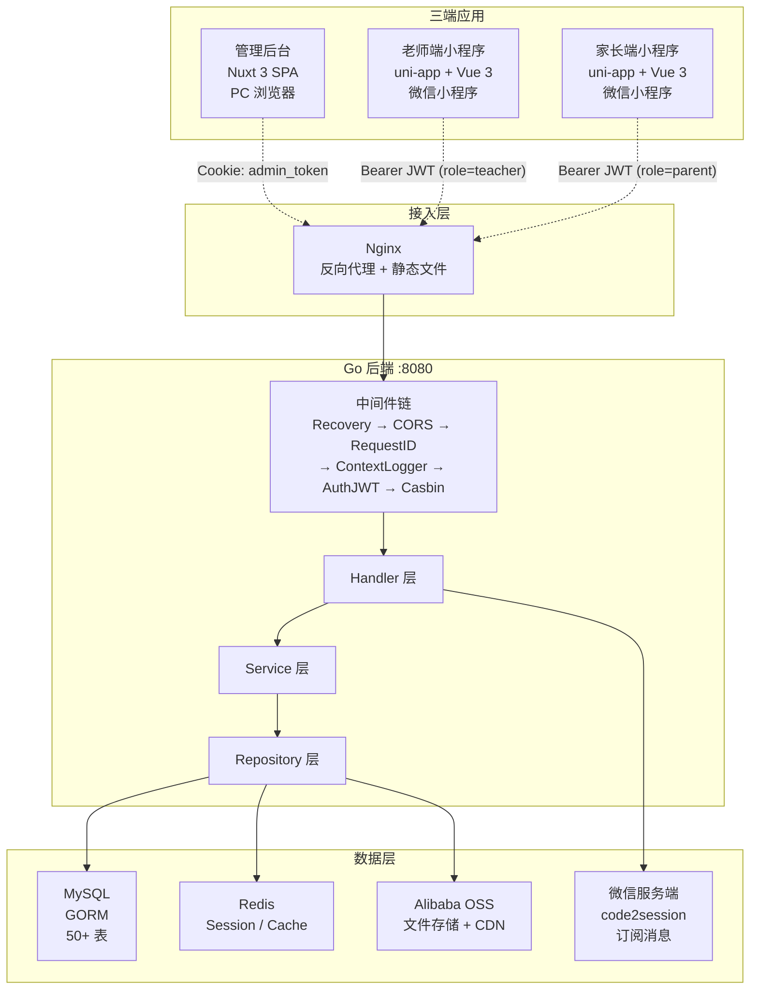

---

## 10.2 权限体系

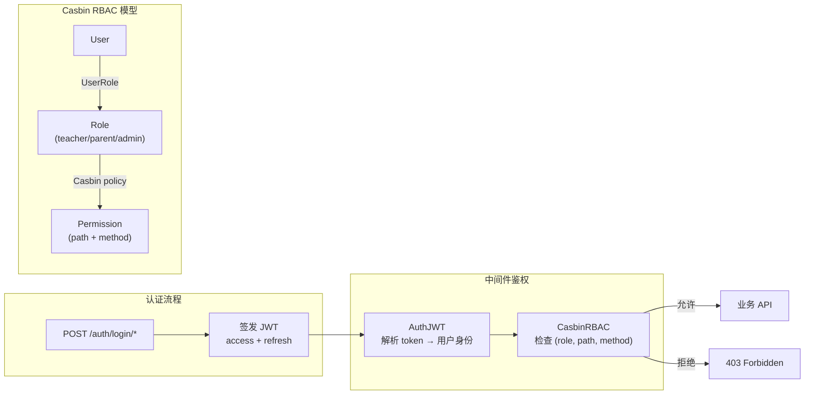

---

## 10.3 管理后台页面导航

```mermaid
graph TD
    Login["/login<br/>登录页"] -->|登录成功| Dashboard["/ (Dashboard)<br/>数据看板"]

    Dashboard --> Classes["/classes<br/>班级管理"]
    Dashboard --> Students["/students<br/>学生管理"]
    Dashboard --> Teachers["/teachers<br/>老师管理"]
    Dashboard --> Parents["/parents<br/>家长管理"]

    Dashboard --> Attendance["/attendance<br/>出勤管理"]
    Dashboard --> Leaves["/leaves<br/>请假管理"]
    Dashboard --> Pickup["/pickup<br/>接送记录"]

    Dashboard --> Growth["/growth<br/>成长记录"]
    Dashboard --> Tasks["/tasks<br/>亲子任务"]
    Dashboard --> Points["/points<br/>积分管理"]
    Dashboard --> Achievements["/achievements<br/>成就管理"]

    Dashboard --> Notices["/notices<br/>通知管理"]
    Dashboard --> Announcements["/announcements<br/>园所公告"]
    Dashboard --> Audit["/audit<br/>内容审核"]
    Dashboard --> Statistics["/statistics<br/>数据统计"]

    Dashboard --> Admins["/admins<br/>管理员管理"]
    Dashboard --> Roles["/roles<br/>角色权限"]
    Dashboard --> Settings["/settings<br/>系统设置"]
    Dashboard --> Logs["/logs<br/>操作日志"]
    Dashboard --> Export["/export<br/>数据导出"]
```

---

## 10.4 老师端页面导航

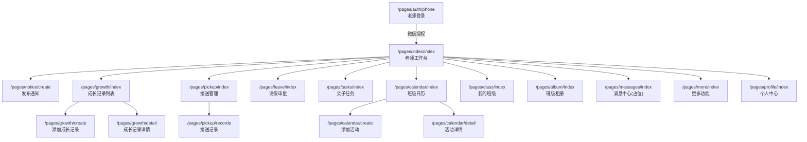

---

## 10.5 家长端页面导航

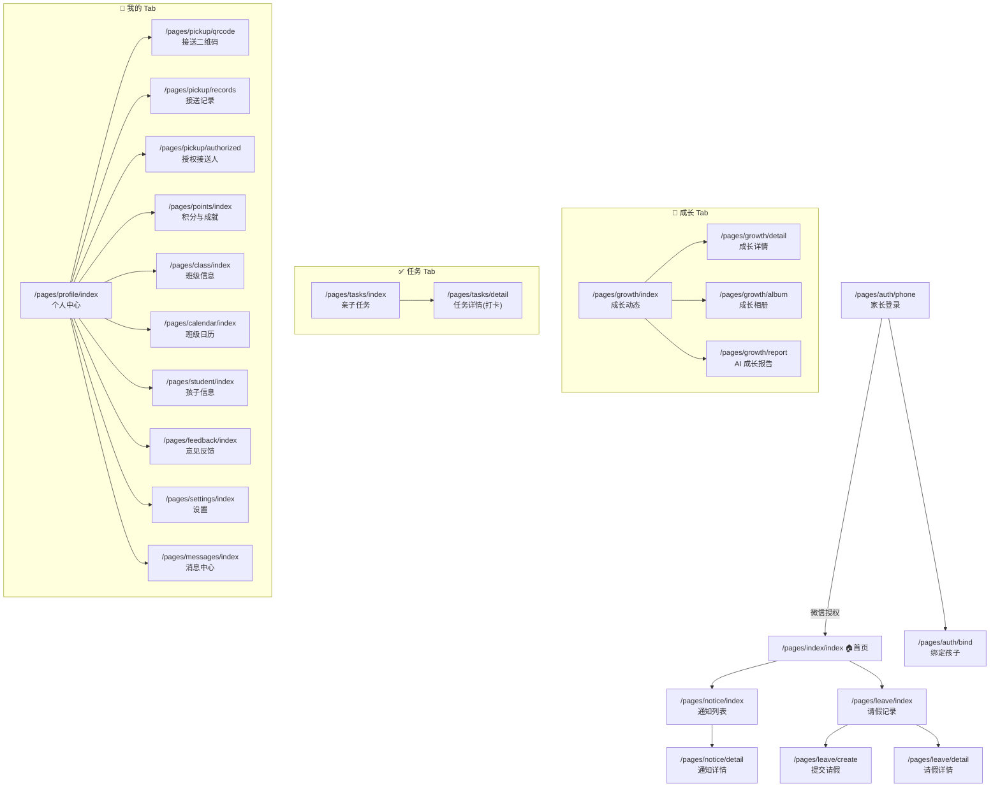

---

## 10.6 核心用户流程

### 10.6.1 老师发布通知流程

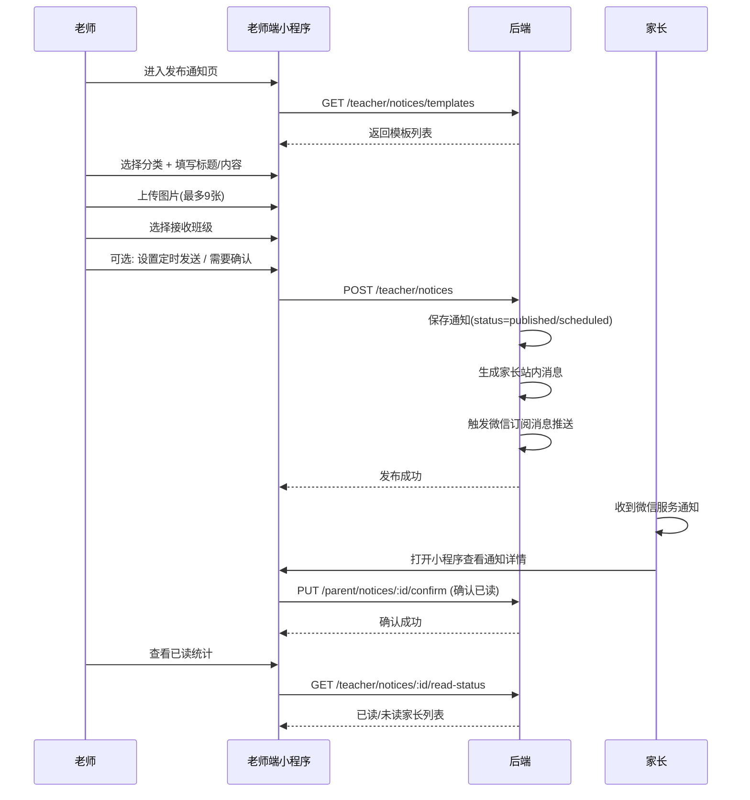

### 10.6.2 老师记录成长 → 家长互动流程

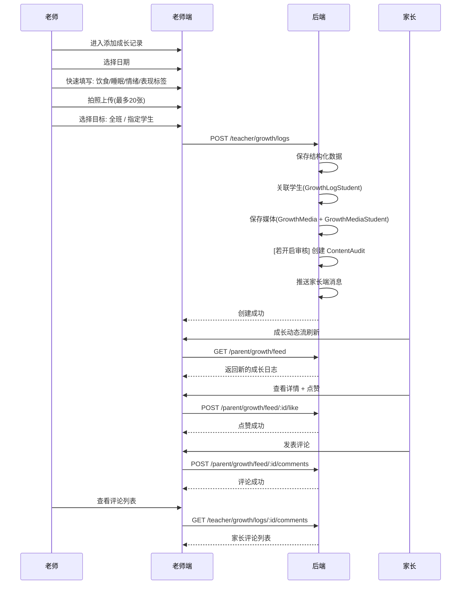

### 10.6.3 接送流程

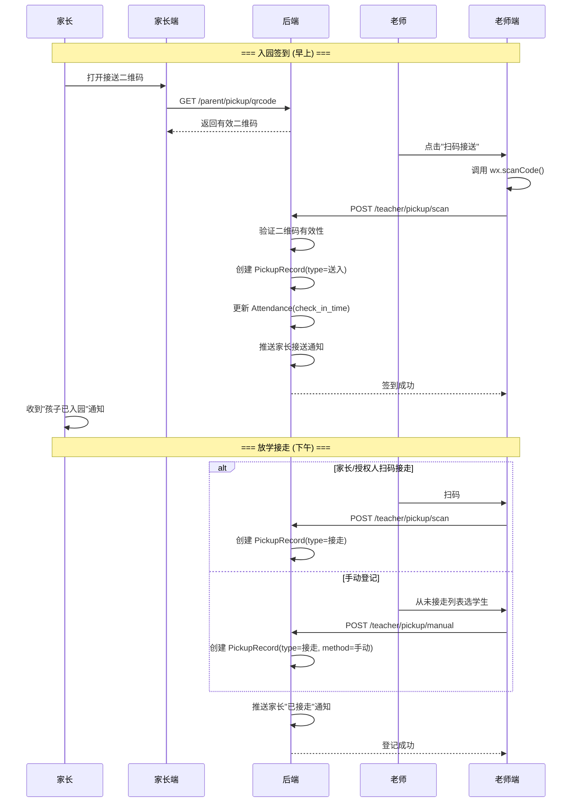

### 10.6.4 请假审批流程

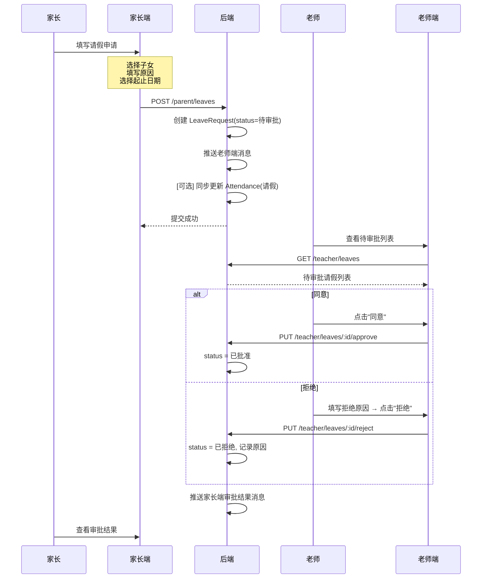

### 10.6.5 亲子任务打卡闭环

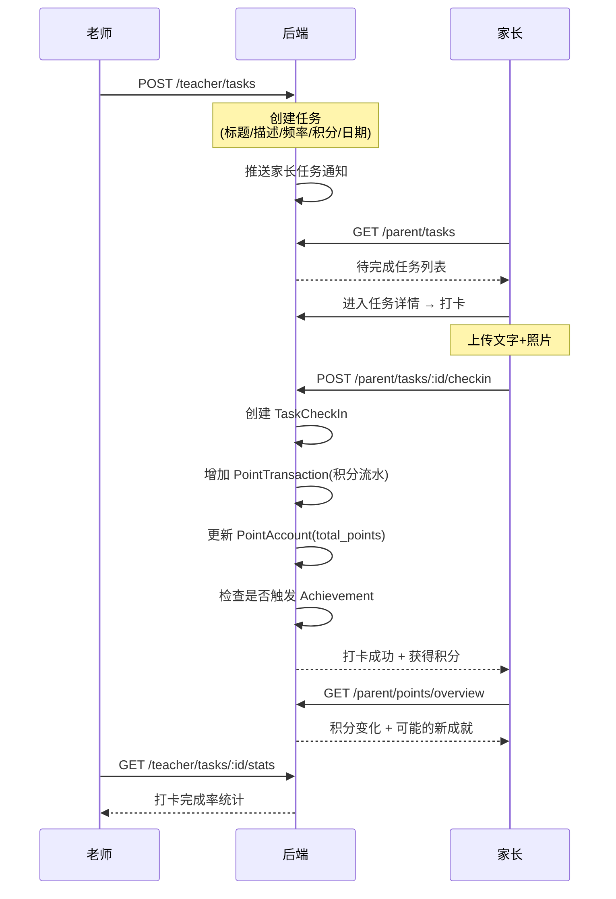

---

## 10.7 关键状态机

### 10.7.1 通知生命周期

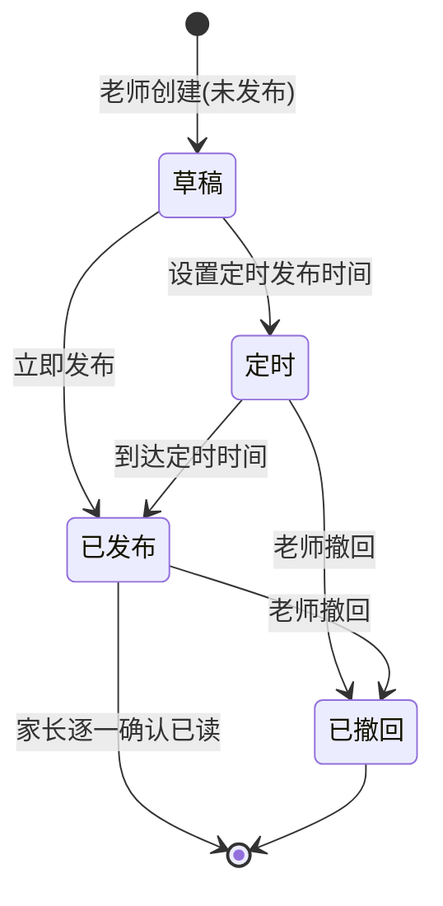

### 10.7.2 请假审批状态机

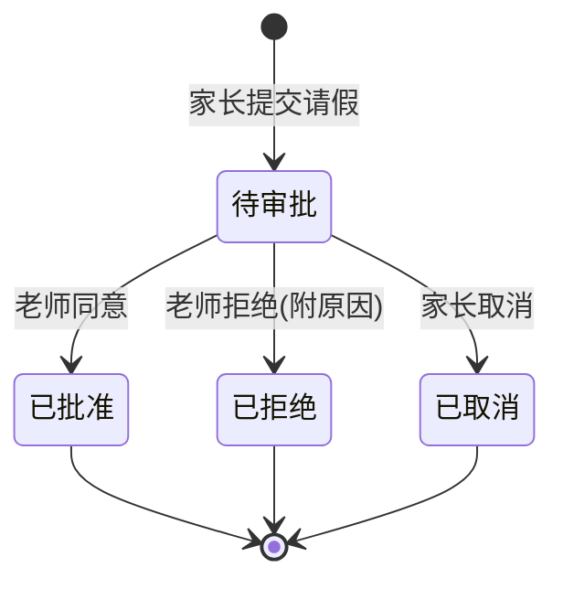

### 10.7.3 内容审核状态机

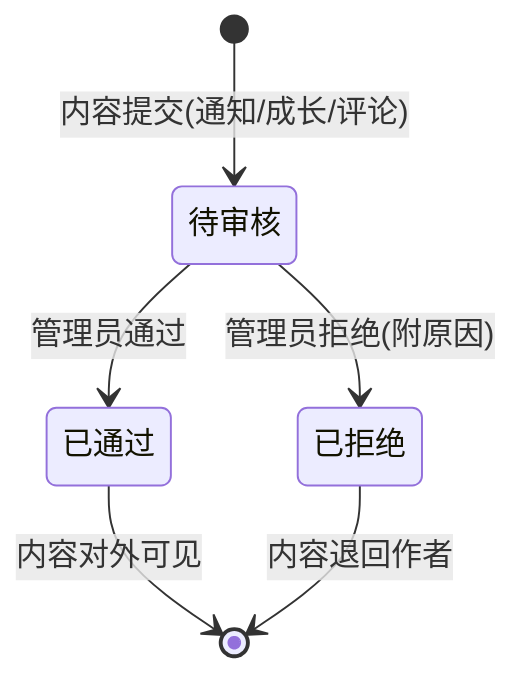

### 10.7.4 授权接送人审核流程

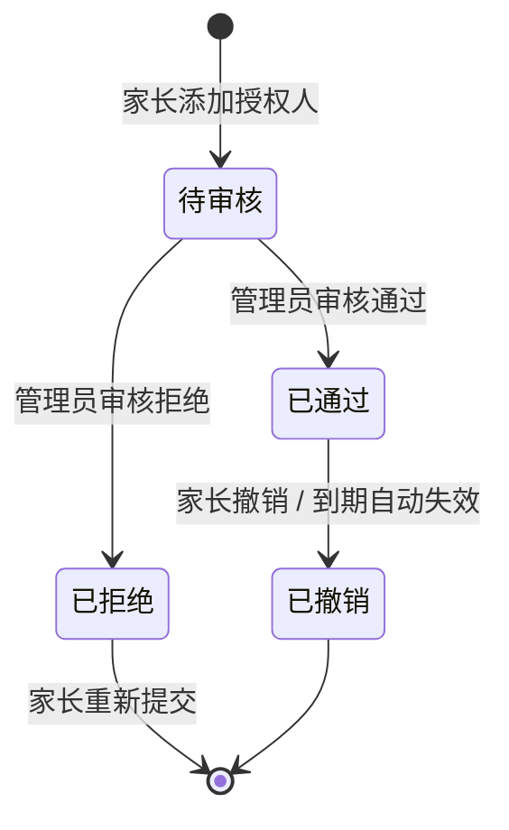

### 10.7.5 学生就读状态

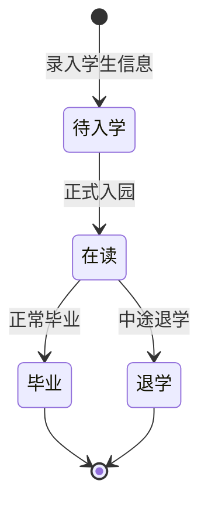

### 10.7.6 导出任务状态

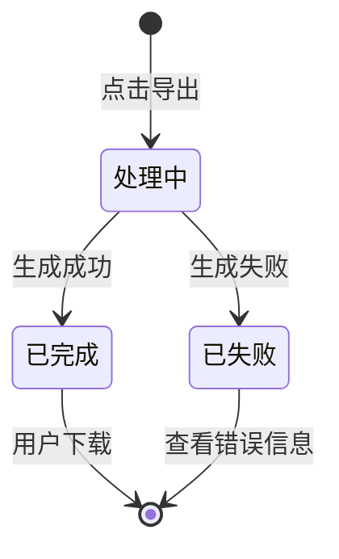

---

## 10.8 核心实体 ER 图

```mermaid
erDiagram
    Kindergarten ||--o{ Class : has
    Kindergarten ||--o{ Student : has
    Kindergarten ||--o{ UserRole : "user belongs to"

    Class ||--o{ Student : contains
    Class ||--o{ ClassTeacher : assigns
    Class ||--o{ Notice : receives
    Class ||--o{ ParentTask : receives
    Class ||--o{ CalendarEvent : schedules

    User ||--o{ UserRole : has
    User ||--o{ ClassTeacher : "is teacher"
    User ||--o{ StudentParent : "is parent"
    User ||--o{ GrowthDailyLog : creates
    User ||--o{ LeaveRequest : submits
    User ||--o{ Message : receives

    Student ||--o{ StudentParent : "linked to parent"
    Student ||--o{ Attendance : records
    Student ||--o{ LeaveRequest : requests
    Student ||--o{ PickupRecord : "picked up"
    Student ||--o{ PickupAuthorization : authorizes
    Student ||--|| PointAccount : owns
    Student ||--o{ TaskCheckIn : completes
    Student ||--o{ GrowthReport : receives

    GrowthDailyLog ||--o{ GrowthMedia : attaches
    GrowthDailyLog ||--o{ GrowthComment : discussed
    GrowthDailyLog ||--o{ GrowthLike : liked
    GrowthDailyLog ||--o{ GrowthLogStudent : "tags students"

    ParentTask ||--o{ TaskCheckIn : "checked in"

    AdminRole ||--o{ AdminRolePermission : grants
    AdminPermission ||--o{ AdminRolePermission : "in role"
```

---

## 10.9 三端功能对照热力图

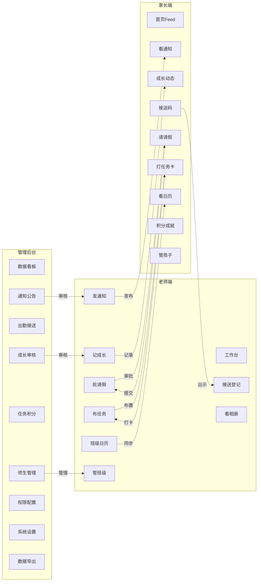

---

> 所有图使用 Mermaid 语法编写。如需导出为图片，可使用 `mermaid-cli`（`mmdc -i 10-产品设计图.md -o output.png`）或在 VS Code 中安装 Mermaid 预览插件直接查看。
